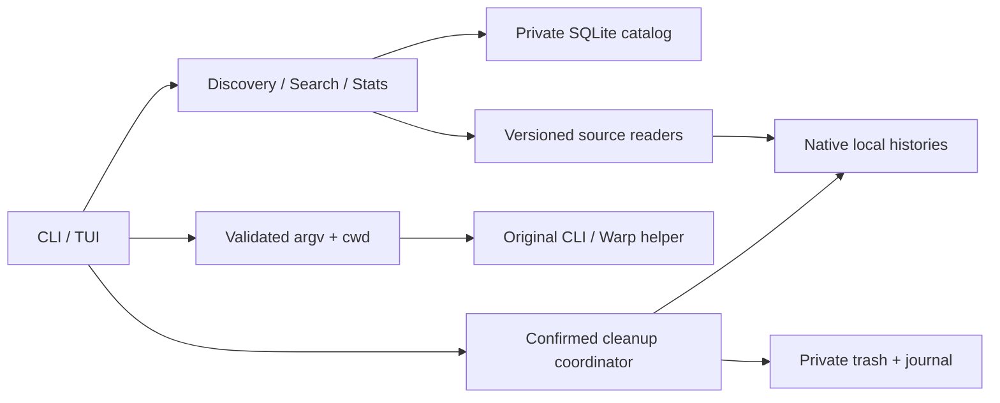

# Implementation Plan: Единый CLI-центр AI-сессий

**Branch**: `001-session-command-center` | **Date**: 2026-11-02 | **Spec**: [spec.md](spec.md)

**Input**: Feature specification from `specs/001-session-command-center/spec.md`

## Summary

Создать локальную команду `sessions`: без аргументов — интерактивный обзор, с подкомандами —
поиск/детали, точное native resume, manager-only скрытие, безопасная корзина и статистика.
Один Python-пакет; native данные читают четыре versioned adapters, собственный SQLite
хранит приватный каталог/поиск/состояния. Никакого сервера, AI-запросов или cloud sync.

Phase 0 завершена: [research.md](research.md). Реальные профили существенно различаются:
Codex использует shared paginated projections; Claude и Codex повторяют usage evidence;
Grok хранит ACP/native files; Cursor — локальный JSON/protobuf-граф.
У Codex 0.166.0 source cleanup отключена из-за неограниченного native cascade.
Cursor lifetime tokens остаются unknown; context occupancy не подменяет расход.

Phase 1 завершена: [data-model.md](data-model.md), [contracts](contracts/cli.md),
[quickstart.md](quickstart.md). Это дизайн, не реализация или заявление о прохождении runtime gates.

## Technical Context

**Language/Version**: Python >=3.12; текущая исследованная среда Python 3.14.8.
Нативные SDK или выполнение кода других инструментов для чтения не требуются.

**Primary Dependencies**: Typer (scriptable commands), Textual (overview/Pilot/suspend),
Rich (table output), tomli-w (Warp TOML). Stdlib для SQLite, typed dataclasses, JSON,
filesystem, processes, hashing и timezone. Exact versions фиксируются uv.lock при реализации.

**Storage**: Приватный SQLite catalog с FTS5 trigram/external content; config.toml,
trash manifests/payload и одноразовые launch manifests в user Application Support.
Исходные JSONL/SQLite/blob stores остаются собственностью native CLI.

**Testing**: Обязательный TDD; pytest, pytest-asyncio, Typer CliRunner, Textual Pilot;
синтетические JSONL/SQLite/WAL/protobuf fixtures и child executables. Ruff — lint/format.
Fault injection и source-neighbor invariants важнее формального процента coverage.

**Target Platform**: macOS текущего пользователя, проверенная локальная arm64-среда;
терминал и установленная Warp. Другие ОС, Cursor IDE и ACP profiles вне первой версии.

**Project Type**: Локальное CLI/TUI-приложение, один пакет, без фонового демона.

**Performance Goals**: SC-002: 10 000 сессий / до 1 ГиБ; cold discovery/readiness <=10 с;
warm meaningful overview, search и navigation <=2 с на целевой машине.
Это обязательный будущий benchmark gate; измеренного результата приложения пока нет.

**Constraints**: Offline read-only discovery/history/search/statistics; отсутствие
native repair/credentials extraction; literal Unicode search; explicit completeness;
safe foreground handoff; mutation только по проверенному source profile и подтверждённому
manifest. Нет generic force, native cloud delete или whole shared-DB rollback.

**Scale/Scope**: Один владелец, четыре CLI, несколько явно заданных локальных roots;
missing/unsupported форматы изолированы. No-arg overview не требует ручного экспорта истории.

## Constitution Check

*GATE: проверено до Phase 0 и повторно после Phase 1.*

| Принцип / требование | До исследования | После дизайна | Доказательство |
| -------------------- | --------------- | ------------- | -------------- |
| I. Clear Requirements | PASS | PASS | 5 user stories, FR-001–FR-027, SC-001–SC-008; traceability ниже |
| II. Simple Design | PASS | PASS | Один пакет/процесс/catalog; 4 нужные runtime libs, без ORM/server/AI SDK |
| III. TDD | PASS | PASS | Red-before-implementation, synthetic fixtures, boundary/fault tests |
| IV. Protected Session Data | PASS | PASS | Private state, inert text, no scan network, capability-gated cleanup/journal |
| V. Documented Changes | PASS | PASS | Source/version matrix, CLI/launch/cleanup contracts, validation guide |
| GitHub / review | PASS | PASS | YehudaItkin/sessions_manager; feature branch; будущая публикация через PR |

Неподдержанная cleanup Codex соответствует FR-009/FR-016 и shared-store edge case;
она не объявляется успешной реализацией удаления. Для остальных sources mutation включается
только после safety gates, не по одному факту чтения истории. Исключений из конституции нет.
Неизвестных продуктовых решений и незавершённых вопросов Technical Context не осталось.

## Project Structure

### Documentation (this feature)

```text
specs/001-session-command-center/
├── spec.md
├── plan.md
├── research.md
├── data-model.md
├── quickstart.md
├── checklists/requirements.md
└── contracts/
    ├── cli.md
    ├── sources.md
    ├── launch.md
    └── cleanup.md
```

tasks.md создаётся следующей командой `$speckit-tasks`, не этим workflow.

### Source Code (repository root)

Планируемая структура; исходные файлы сейчас не создаются:

```text
pyproject.toml
uv.lock
src/sessions_manager/
├── __init__.py
├── __main__.py
├── cli.py
├── config.py
├── models.py
├── catalog.py
├── discovery.py
├── search.py
├── statistics.py
├── activity.py
├── cleanup.py
├── fsops.py
├── launch.py
├── warp.py
├── sources/
│   ├── base.py
│   ├── codex.py
│   ├── claude.py
│   ├── grok.py
│   ├── cursor.py
│   ├── sqlite_reader.py
│   └── cursor_wire.py
└── ui/
    ├── app.py
    └── screens.py
tests/
├── unit/
├── contract/
├── integration/
├── acceptance/
├── performance/
├── fixtures/
└── support/make_corpus.py
```

**Structure Decision**: CLI и TUI обращаются к общим функциям приложений и models;
adapters изолируют native schemas. Отдельные fsops/launch нужны из-за реальных границ
безопасности, не для построения framework. Tests support генерирует искусственные корпуса,
а приватные runtime data не располагаются под repository root.

## Design Decisions and Boundaries



- Discovery использует только configured roots и direct readers. Scan workers ограничены,
  один writer публикует согласованные session generations. UI не ждёт полный длинный scan,
  но всегда отличает cached/stale/partial от полного результата.
- Metadata-first даёт ранний обзор; content indexing идёт в том же управляемом refresh.
  Частичный индекс не считается выполнением полного поиска или SC-002.
- Каталог обновляется по source revisions/fingerprints; замена/усечение JSONL пересобирает
  соответствующую историю, append читает только новый подтверждённый хвост.
  Корень с ошибкой не вызывает массовое исчезновение ранее известных сессий.
- Refresh полностью обновляет все настроенные корни выбранных источников; project/date
  filters применяются только к выводу. Записи вне фильтра обновляются, невыбранные roots
  сохраняют прежние generation/as_of и не помечаются missing.
- Каждая строка обзора различает display_id и native_id. Визуальное сокращение допустимо;
  полные значения сохраняются в деталях/JSON и используются для selection/native resume.
- Search хранит casefolded chunks; FTS trigram даёт кандидатов, final literal check — истину.
  Short query и %/_ имеют ту же семантику; metadata/native text не исполняются.
- Usage ledger хранит уникальные facts и many-to-many memberships; snapshots и context
  occupancy отдельны. Перекрывающиеся истории не дают двойного суммирования.
- Read-only native SQLite учитывает WAL и не создаёт sidecars/repair. Paired Codex DB
  snapshots имеют проверку совместимости и as_of range; атомарность между ними не выдумывается.
- Resume использует exact native IDs, абсолютные executables и cwd. Установленный
  generic agent не используется как Cursor. Нестандартный read root не даёт resume
  capability без доказанной связи с native runtime.
- Исходный history_locator отделён от execution cwd. Перенос проекта требует проверки
  привязки к прежней истории для выбранного профиля; при unsupported/unverified binding
  CLI не запускается, а вместе доступны причина, другая папка/отмена и manual guide.
  Непроверенные инструкции не выдаются за работающие команды.
- Warp — documented Tab Config + one-shot helper, не UI typing и не invented URI command.
  Config не содержит session metadata; timeout не запускает второй процесс автоматически.
- Trash работает только с exact proven bundles, verified backups, same-device no-replace
  operations и durable journal. Unknown activity требует closed assertion, известный
  writer запрещает действие. Необусловленная защита от нарушившего эти условия native writer
  не обещается; такой риск не скрывается за stat check или manager lock.
- Cross-device cleanup и Codex paginated cleanup недоступны в первом compatibility profile.
  Статистика, просмотр и скрытие от этого не пропадают.

## Validation and Delivery Gates

Все behavioral изменения начинаются с ожидаемо падающего теста. Ниже группы будущих
проверок, не сгенерированный tasks.md и не отчёт о выполнении тестов приложения.

| Граница | Требования | Критерии | Проверки |
| ------- | ---------- | -------- | -------- |
| Sources / overview | FR-001–FR-005, FR-008–FR-009, FR-026 | SC-001, SC-002, SC-008 | Четыре native shapes, WAL/projections, corrupt/unknown/absent, stable IDs |
| Search / history | FR-004, FR-006–FR-007, FR-024–FR-025 | SC-002, SC-003, SC-007 | Casefold/literal/date bounds, pagination, inert text, aliases/forks |
| Resume / Warp | FR-009–FR-012, FR-025–FR-026 | SC-004 | Exact argv/cwd, missing context, TUI handoff, one-shot/timeout, synthetic Warp |
| Hide / cleanup | FR-013–FR-019, FR-025–FR-026 | SC-006 | No-op cancel, active block, copy/fsync/rename faults, retry/restore conflict, neighbors |
| Usage | FR-020–FR-024 | SC-005, SC-007 | Receipts vs snapshots, global fact union, categories/coverage, Cursor unknown |
| TDD / isolation | FR-027 | Все SC | Synthetic-only roots, no network scan, no source data/log/fixture leakage |

Последовательность будущей реализации: базовые модели/catalog и source contracts;
обзор четырёх источников; история/поиск; resume/терминал/Warp; manager hide и проверенная
cleanup; статистика. Общие файлы сериализуются в порядке US1→US2→US3→US4→US5 из tasks.md.
Сквозной benchmark проводится рано, до закрепления неработоспособной схемы индекса.

Release gates:
1. Каждый поддержанный native profile проходит positive/negative fixture suite.
2. Каждая включённая mutation проходит fault/race/recovery tests; иначе capability unavailable.
3. Synthetic Warp runtime проверяется отдельно от доставки URI; real native resume требует
   осознанной ручной проверки владельца и не запускается во время планирования.
4. SC-002 измеряется на согласованном корпусе/машине. Превышение блокирует выпуск;
   target не ослабляется, partial не маркируется complete.
5. Ruff и relevant pytest suites проходят; docs/CLI contracts обновлены; GitHub PR содержит
   validation evidence. Личных историй, catalogs/fixtures corpora и credentials в diff нет.

[quickstart.md](quickstart.md) задаёт команды и ожидаемые результаты после реализации.
Текущая верификация планирования — структура/ссылки/traceability и read-only research,
не запуск отсутствующего приложения.

## Risks

- Native schemas не являются стабильным общим API. Версия/shape drift даёт явную деградацию
  отдельных capabilities, не бесшумное чтение чужого формата.
- Проекции/истории могут быть неполными или удалены родным retention. Менеджер не обещает
  восстановить отсутствующий native conversation из одного индексного заголовка.
- Подстрочный поиск короткого запроса и cold 1 ГиБ indexing могут стать bottleneck.
  Benchmark gate обязателен; выбор Python не считается заранее доказанным по скорости.
- Source process может держать FD после rename. Условие закрытости, live evidence и
  fail-closed source profiles обязательны, а whole-DB rollback недопустим.
- Warp delivery асинхронна и зависит от установленной версии. Поддержка исследованного
  build — аргументированная совместимость; end-to-end доказывается отдельной проверкой.

## Complexity Tracking

Нарушений конституции и разрешений на её обход нет. Bounded Cursor wire reader,
операционный журнал и launch helper обоснованы конкретными native форматами и рисками
R6/R10/R11; это части одного приложения, не отдельные сервисы.

## Native compatibility amendment — 2026-11-03

Existing bounded readers/version probe are extended; no dependency or service is added.
Cursor projects binary hash refs and shell turns without vendor JS execution; missing
sidecars use verified workspace evidence. Codex selects whitelisted history_mode and
allows 0.166.0 paginated resume without rollout/new cwd after an isolated native gate.
Human explanations are a presentation-only mapping; JSON contracts and journals retain
stable codes. Shared native DB writes, Grok remote delete and Codex cascade mutations
remain excluded because exact local scope/recovery is not established.

Constitution recheck: changes trace to T109–T116 and spec amendments; regression tests
fail before implementation; no personal history is modified or committed. Native gate
uses fresh private roots/offline loopback and no credentials. Review/merge remains via
GitHub PR; Warp failed gate is explicit, never reported as a pass.

## Filtering/sorting amendment — 2026-11-04

Extend existing QuerySpec with model/activity/order and a fixed allowlist of sort fields;
reuse it in CLI and TUI. Separate missing-value partition and stable session_uid ties
preserve unknown-last behavior for ascending and descending. No SQL interpolation, new
dependency, source read, migration or cross-session preference store is needed. Add a
visible filter/sort toolbar and summary, labelled multi-source dialog, direction control,
header click handling and visible-selection batch reconciliation. CLI compatibility keeps
recent/oldest and existing defaults; all new arguments validate before runtime startup.

Constitution check: outcomes/acceptance above precede implementation; unit/CLI/Pilot
regressions are written and observed RED before changes. Use only synthetic catalogs for
acceptance. Query changes are manager presentation only; native cleanup/resume limits
remain as recorded. Full/relevant, package and SC-002 warm checks plus documented self-review
precede the authorized GitHub PR/merge. Simpler alias-only changes were insufficient for
multi-source controls and discoverability; no separate filter engine is introduced.


## Convergence implementation decisions — 2026-11-05

T126–T139 retain the original architecture and add only manager-owned state.
Bounded readers publish an early metadata phase before optional history/usage,
with one caller/writer publishing each phase. Additive generation payloads record
actual reader start/end, completeness and source fingerprint ranges. Interrupted
phases never prune unseen locations or claim complete search/usage.

History stores logical native identities separately from content revisions.
Memberships retain per-session context; conflicting revisions remain distinct and
explicitly partial, preserving each session's search index and logical message
counts. The normalizer version forces reindexing of old caches.

JSONL parser checkpoints store compressed whitelisted records in the private
catalog, associated with the owning session and root. This reuses the established
normalizers for streaming, receipts and compaction. The simpler alternative of
normalized-state-only cursors would require three parallel incremental parsers
with independent streaming/usage recovery semantics. Extra private storage and
one prefix verification pass are the tradeoffs. Native dev/inode, offset,
normalizer/profile version and SHA-256 prefix must match before tail decoding;
replacement, truncation, corruption or drift rebuilds. This optimizes JSON
parsing, not total disk bytes: the old prefix is read to prove it is unchanged.
Purge removes the selected session's checkpoint; neighboring checkpoints remain.

Public CLI changes are additive: overview handles/matches and actions, literal
original-text match context, statistics selection and activity range, and Cursor
context-only counters. The all-session statistics default remains unchanged.
Native mutation guards are retained; shared Grok feasibility is concluded as
unavailable, and Warp runtime remains externally blocked rather than passing.


## Phase 10 boundary and lifecycle decisions — 2026-11-05

Private directories bind a descriptor walk from `/` before creation/use. Owners and
write permissions are checked at every ancestor; only root-controlled platform aliases
are rebound to canonical paths, and root-owned sticky parents are permitted. Native
artifact scope rejects lexical dot-dot before resolution or filesystem mutation.
Existing user directories are never chmodded.

Enumeration records errors explicitly instead of relying on glob's suppressed errors.
JSONL checkpoint projection has depth/node limits; ordinary worker exceptions become
partial root results, while control interrupts propagate. Available neighbors/cached
history are retained and unavailable roots do not establish absence.

Alias reconciliation reuses SessionLocation with optional private payloads containing
native metadata/capabilities, fingerprint, versioned graph/content digest and refresh
cycle. This evidence is stored only for namespaces with multiple configured roots.
Metadata cannot replace an available full snapshot; pending known copies block dangerous
actions, actual conflicting copies suppress ambiguous content, and matching fresh copies
permit resume. Cleanup still requires one proven location. Launch checks the current
read-only catalog guard plus every agreed native fingerprint immediately before handoff.
The simpler aggregate-signatures approach lost per-copy capabilities and freshness when
metadata/full phases arrived in different orders; location evidence fixes that within
the existing catalog, without a coordinator service or transcript duplication.

sessions.current_trash_id binds derived cache retention to the current trash generation.
Legacy ownership is inferred only for one unambiguous active entry. Verified full native
history may revive a stable hidden/session ID; headers, metadata and projection-only
Codex records cannot. A committed purge receipt remains terminal even when final private
manifest/directory removal or fsync fails. cleanup_pending exposes that residual work,
keeps a nonzero CLI result and resumes the same operation after restart without accepting
new contents. No new source paths enter retry scope.

Constitution recheck: Phase 10 code changes follow observed failing synthetic regressions;
manager migrations are additive, source readers remain read-only, and no dependency is
added. Native Warp T113/T130/T144 remains blocked by the recorded access denial; Codex
T118 and Grok shared-index capability gates are unchanged. Package, full suite and the
unchanged SC-002 corpus thresholds are required before authorized GitHub delivery.


## Codex archive decision — 2026-11-05

FR-028 adds a native archive coordinator beside the existing file-trash coordinator,
reusing its manager operation lock. Only native app-server archive/unarchive RPCs mutate
Codex; a bounded read-only native state/graph snapshot defines the exact preview. The
existing single catalog stores private plans/progress/prestates without transcript copies.
A mandatory closed-set assertion and observed-writer checks define the supported profile;
no native atomic/revision lock is claimed. Post-call state verification catches partial
cascades, and restart retries reconcile the same confirmed IDs. New/unexpected descendants
block retry rather than silently widening scope. Separate UI/listing retain archived
sessions, while ordinary overview/stats exclude them. No dependency or daemon is added.

A generic reuse of filesystem trash cannot restore shared paginated stores; a plain
archive command cannot verify partial cascade or remember prior archived children. The
small native coordinator/journal is therefore required. Native gate uses a fresh offline
CODEX_HOME and only artificial histories; fixture graph construction is confined to test
support, never production code or personal stores. Existing Codex cleanup and Warp gates
remain unchanged. TDD, full/package/SC-002 and GitHub review precede integration.


Native archive consistency follow-up: archive/unarchive both cascade in the installed
build, so journaled parent-first reconciliation restores prior flags. Plans/operations
are validated on persistence boundaries. Actual executable version is probed independently
of a config claim. Resume reads pending native operation scope from the private catalog
without creating state. SessionLocation retains post-operation observation watermarks;
older reader results cannot undo verified flags or publish stale content as fresh. Native
archive explicitly invalidates content/usage caches; one Codex refresh rebuilds them.
This avoids a new cache service or duplicate transcript index. All source mutations remain
native RPC; filesystem inventory is validation/hash-only.
