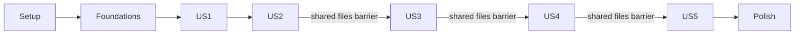

# Tasks: Единый CLI-центр AI-сессий

**Input**: Design documents from `specs/001-session-command-center/`
**Branch**: `001-session-command-center`
**Created**: 2026-11-02
**Prerequisites**: [plan.md](plan.md), [spec.md](spec.md), [research.md](research.md),
[data-model.md](data-model.md), [CLI](contracts/cli.md), [sources](contracts/sources.md),
[launch](contracts/launch.md), [cleanup](contracts/cleanup.md), [quickstart](quickstart.md).
**Tests**: Обязательны по запросу владельца, конституции и FR-027; используется TDD.
**Organization**: Setup → foundations → пять пользовательских сценариев по приоритету → polish.
Статус реализации и проверки отражён checkbox каждой задачи; evidence — в validation.md.

## Format: `[ID] [P?] [Story] Description`

- Каждая задача имеет checkbox, последовательный T-ID и точные project-relative file paths.
- [P] означает готовую независимую файловую работу внутри указанной волны, не разрешение
  игнорировать dependencies/phase barriers. Это не поручение автоматически запускать агентов.
- [US1]–[US5] есть только у задач пользовательских фаз; setup/foundation/polish не имеют story label.
- Блок Tests пишется и запускается до соответствующего production behavior. В implementation
  входят только минимальные изменения для green и последующий refactor с passing tests.
- Red должен относиться к ожидаемому новому поведению, а не сломанному окружению или
  невалидной фикстуре. Уже работающий negative/safety case не требуется искусственно ломать.
- Общие models/catalog/cli/ui и provider files редактируются только в порядке зависимостей.
  Параллельная волна заканчивается перед переходом Tests → Implementation.

## Path Conventions

Один пакет: `src/sessions_manager/`; тесты: `tests/unit/`, `tests/contract/`,
`tests/integration/`, `tests/acceptance/`, `tests/performance/`;
генераторы/harmless children: `tests/support/`. Все пути ниже от repository root.
Private data-dir, generated corpora и native histories находятся за пределами репозитория.
Фразы «Модель: …» цитируют field/validation constraints из data-model.md; они обязательны.

---

## Phase 1: Setup (Shared Infrastructure)

**Purpose**: Создать пакет, locked окружение и изолированный test harness. Ни истории владельца, ни исходные CLI не используются как test inputs.

- [X] T001 Инициализировать Python >=3.12 пакет sessions-manager и console entry sessions; зафиксировать runtime/dev зависимости через uv. Файл: `pyproject.toml`.
  Также: `uv.lock`, `src/sessions_manager/__init__.py`.
  Зависимости: нет.
  Typer, Textual, Rich, tomli-w; pytest, pytest-asyncio и Ruff в dev group. Создать только package
  scaffold, без бизнес-логики; поддержать uv sync --locked --group dev.

- [X] T002 [P] Исключить окружение, generated corpora, приватные runtime данные и отчёты тестов из Git. Файл: `.gitignore`.
  Зависимости: нет.
  Не исключать synthetic fixture seeds или uv.lock; не менять существующие tracked Spec Kit templates.

- [X] T003 [P] Настроить изоляцию тестов, временные roots, сетевой запрет и явные opt-in параметры. Файл: `tests/conftest.py`.
  Также: `tests/support/__init__.py`, `tests/support/fake_cli.py`.
  Зависимости: T001.
  Зарегистрировать --run-warp и --corpus; fixture config использует discovery_roots_mode=replace. Не
  переопределять HOME и не читать production histories; harmless fake children вместо AI CLI. Общий
  harmless child пишет только synthetic argv/cwd/ack в свой fixture root; не читает credentials и не
  требует production CLI.

**Checkpoint**: Scaffold и test harness готовы; runtime behavior ещё не считается реализованным.

---

## Phase 2: Foundational (Blocking Prerequisites)

**Purpose**: Общие модели, приватные данные, native read-only boundary, catalog и CLI plumbing. Это блокирует все пользовательские сценарии.

**Blocking gate**: Setup завершён; foundations полностью завершаются до US1.

### Tests (обязательный TDD / RED)

- [X] T004 [P] Написать и запустить падающие проверки общих value types, identities, capabilities и generations. Файл: `tests/unit/test_models.py`.
  Зависимости: T001, T002, T003.
  Проверить enums/null/UTC/integer-vs-bool, stable ID через refresh/root move, aliases, конфликт
  одинаковой identity, persistent hide tombstone и отсутствие права resume у surrogate.

- [X] T005 [P] Написать и запустить падающие проверки config, namespace roots, приватности data-dir и безопасных diagnostics. Файл: `tests/unit/test_config.py`.
  Зависимости: T001, T002, T003.
  Проверить standard roots, explicit replacements, view-only custom roots, owner/mode rejection без
  chmod чужих каталогов, отсутствие credentials в persisted context и логах.

- [X] T006 [P] Написать и запустить падающие проверки read-only native SQLite boundary. Файл: `tests/integration/test_native_sqlite.py`.
  Зависимости: T001, T002, T003.
  Реальный synthetic WAL, missing sidecars, busy/read retries, malicious view/schema,
  query_only/trusted_schema, запрет DDL/DML/repair/checkpoint/immutable на live source; исходные
  main/WAL bytes не меняются.

- [X] T007 [P] Написать и запустить падающие проверки version/shape profiles и отказа неподдержанной возможности. Файл: `tests/contract/test_source_profile.py`.
  Зависимости: T001, T002, T003.
  Состояния discover/history/resume/usage/cleanup независимы; CLI version не заменяет schema
  predicate. Unknown format — unavailable с причиной, а не пустой успешный source.

- [X] T008 [P] Написать и запустить падающие проверки собственного catalog и миграций. Файл: `tests/integration/test_catalog.py`.
  Зависимости: T001, T002, T003.
  Проверить foreign keys, уникальность namespace/native_id, parameter binding, атомарную session
  generation, один writer/read connections и отсутствие native-schema migrations.

- [X] T009 [P] Написать и запустить падающие проверки глобального CLI-контракта, help/version и error envelope. Файл: `tests/contract/test_cli_common.py`.
  Зависимости: T001, T002, T003.
  contracts/cli.md: --config/--data-dir/--format, schema_version=1, stdout JSON/stderr safe
  diagnostics и exit codes 0/1/2/3/4/5/6/7/8/130. Help/version не сканируют roots.

### Implementation (после соответствующего RED)

- [X] T010 Реализовать общие модели SourceRoot, Session, SessionLocation, Project, ActivityEvidence и ScanGeneration. Файл: `src/sessions_manager/models.py`.
  Зависимости: T004.
  Включить все поля data-model.md §1–3, typed validation, schema/generation provenance;
  normalizer_version учитывает Unicode version. Native account tokens не нужны для namespace.
  Модель: «Все ID — строки с типом/namespace; пользовательский ID не является номером строки.».
  Модель: «Время: UTC epoch milliseconds либо null, плюс provenance и timezone-confidence.».
  Модель: «Счётчики: неотрицательный integer либо null; bool не принимается как число.».
  Модель: «Полнота: complete / partial / unavailable / stale с причиной и as_of.».
  Модель: «Возможность действия: supported / unavailable / unsafe с machine-readable reason.».
  Модель: «Native paths — абсолютные; нормализация пути не заменяет проверку владельца, symlinks и
  допустимой области операции.».
  Модель: «Стабильный UUID локальной конфигурации».
  Модель: «codex / claude / cursor / grok».
  Модель: «Логический профиль одного источника, не путь и не прочитанный account token».
  Модель: «Native home или явно добавленное history location».
  Модель: «Проверенный формат, независимо от версии executable».
  Модель: «Разрешённый native CLI либо null».
  Модель: «Доказанная связь этого расположения с native CLI; иначе view-only».
  Модель: «Детерминированный полный UUID от namespace + native_id».
  Модель: «Стабильный полный человекочитаемый handle; краткая форма только при уникальности».
  Модель: «Составная уникальная принадлежность».
  Модель: «Только whitelisted значения; null допустим».
  Модель: «Постоянный manager-only признак».
  Модель: «present / source_unavailable / missing / trashed / purged».
  Модель: «active / inactive / unknown и ссылка на ActivityEvidence».
  Модель: «Независимые metadata/history/search/resume/usage/cleanup с причинами».
  Модель: «preferred/alias/conflict status».
  Модель: «state (running / complete / partial / failed / cancelled)».
  Модель: «При отсутствии native_id назначается постоянный surrogate по проверенной identity
  артефакта; наличие surrogate не разрешает resume/delete без доказанной связи.».
  Модель: «Тот же native_id разных providers/namespaces не смешивается.».
  Модель: «Совпадающие aliases не дублируют строку.».
  Модель: «Несовместимые содержимые с одной identity дают identity_conflict; не выбирается случайная
  копия, а опасные действия отключаются.».
  Модель: «Fingerprint для инвалидации включает dev/inode/size/mtime_ns и native revision/cursor; это
  не доказательство inactivity.».
  Модель: «Cwd берётся из native metadata, не угадывается из encoded directory name.».
  Модель: «Визуальное сокращение ID не меняет его значения; show и JSON содержат полные ID.».

- [X] T011 [P] Реализовать приватные пути/config, root namespaces и безопасные diagnostic results. Файл: `src/sessions_manager/config.py`.
  Зависимости: T010, T005.
  Default user Application Support, config.toml, catalog.sqlite3, trash/launches; code/repository cwd
  не используются для runtime state. Persist только явный config и allowlisted native-home context.
  Модель: «Новые директории 0700, файлы/DB/WAL/SHM 0600, umask 077; существующий чужой/небезопасный
  data-dir вызывает отказ без автоматического chmod пользовательских каталогов.».
  Модель: «Diagnostics содержат коды и агрегаты, не содержимое событий или секреты.».
  Модель: «Перемещение корня не меняет namespace.».
  Модель: «Добавление произвольной копии не даёт права продолжать её через другой native home.».

- [X] T012 [P] Реализовать ограниченный reader native SQLite без source mutation. Файл: `src/sessions_manager/sources/sqlite_reader.py`.
  Зависимости: T010, T006.
  URI mode=ro, query_only=ON, trusted_schema=OFF, disabled extensions и table/type whitelist; короткие
  snapshots, WAL, максимум два retry; никаких новых sidecars или immutable. data_version сравнивать в
  той же connection, paired DB имеют as_of range.

- [X] T013 [P] Реализовать общий typed source contract и registry совместимости. Файл: `src/sessions_manager/sources/base.py`.
  Зависимости: T010, T007.
  Из contracts/sources.md: probe/discover, capability/reason и source revisions; story-specific
  интерфейсы добавляются по мере реализации. Не объявлять неподдержанные функции успешно
  реализованными.

- [X] T014 Реализовать приватный catalog, базовую схему и собственные миграции. Файл: `src/sessions_manager/catalog.py`.
  Зависимости: T010, T011, T008.
  Persist roots/sessions/locations/projects/activity/generations; один writer, separate readers,
  FK/unique constraints и атомарная публикация. Failure корня не mass deletion; retain identity/hide
  tombstones.
  Модель: «Каталог SQLite использует один writer и отдельные read connections для workers/UI.».
  Модель: «Foreign keys, параметризованные запросы и явные транзакции обязательны.».
  Модель: «Миграции только собственного каталога; native schemas никогда не мигрируются менеджером.».

- [X] T015 Реализовать entrypoint, глобальные опции, JSON envelope и безопасную обработку ошибок. Файл: `src/sessions_manager/cli.py`.
  Также: `src/sessions_manager/__main__.py`.
  Зависимости: T011, T014, T013, T009.
  Подключить Typer без eager scanning на import/help/version; общий renderer/error mapping и lazy
  entry для последующего overview. Не добавлять фиктивные успешные команды отсутствующего поведения.

**Checkpoint**: Typed foundation, приватность, source boundary и собственные migrations проходят соответствующие тесты; можно начинать US1.

---

## Phase 3: User Story 1 - Сразу увидеть свои сессии (Priority: P1) — MVP

**Goal**: Один no-argument overview четырёх локальных источников с устойчивыми ID, metadata, activity/capabilities и честными health/partial состояниями.

**Independent Test**: Изолированный corpus четырёх providers: один запуск показывает ожидаемые сессии без дублей; unreadable source не скрывает здоровые, отсутствие CLI не скрывает читаемую историю. Смена порядка/refresh сохраняет IDs, пустое состояние объясняет проверенные roots.

**Traceability**: FR-001–FR-005, FR-008–FR-009, FR-026; SC-001, ранний SC-002, SC-008; US1 scenarios 1–4.

### Tests for User Story 1 (обязательный TDD / RED)

- [X] T016 [P] [US1] Написать и запустить падающие metadata/discovery contract tests Codex. Файл: `tests/contract/test_codex_metadata.py`.
  Также: `tests/support/codex_factory.py`.
  Зависимости: T004, T005, T006, T007, T008, T009, T010, T011, T012, T013, T014, T015.
  Synthetic 0.166.0 state_5/thread_history_1 + JSONL; metadata без rollout, missing projection,
  ms/seconds, unknown shape, denied root. Codex paginated cleanup всегда
  unavailable/native_cascade_unbounded.

- [X] T017 [P] [US1] Написать и запустить падающие metadata/discovery contract tests Claude. Файл: `tests/contract/test_claude_metadata.py`.
  Также: `tests/support/claude_factory.py`.
  Зависимости: T004, T005, T006, T007, T008, T009, T010, T011, T012, T013, T014, T015.
  Synthetic projects/<project>/<id>.jsonl и companions; source cwd/title/time из записей, не folder
  decoding; duplicate IDs, отсутствующий CLI, неизвестный record shape и shared neighbors.

- [X] T018 [P] [US1] Написать и запустить падающие metadata/discovery contract tests Grok. Файл: `tests/contract/test_grok_metadata.py`.
  Также: `tests/support/grok_factory.py`.
  Зависимости: T004, T005, T006, T007, T008, T009, T010, T011, T012, T013, T014, T015.
  Synthetic 1.0.70 summary/info.id/cwd/source dates; images-only stub не session; сторонний grok.db
  исключён; ни list/search/export, ни cloud/native delete не вызываются.

- [X] T019 [P] [US1] Написать и запустить падающие metadata/discovery contract tests Cursor. Файл: `tests/contract/test_cursor_metadata.py`.
  Также: `tests/support/cursor_factory.py`.
  Зависимости: T004, T005, T006, T007, T008, T009, T010, T011, T012, T013, T014, T015.
  Synthetic per-chat meta.json/store.db с hex meta['0']; whitelisted metadata, malformed
  hex/WAL/unknown version; blobEncryptionKey не сохраняется/выводится; IDE/ACP не импортируются как
  CLI.

- [X] T020 [P] [US1] Написать и запустить падающие проверки scan coordinator, roots и generation reconciliation. Файл: `tests/integration/test_discovery.py`.
  Зависимости: T004, T005, T006, T007, T008, T009, T010, T011, T012, T013, T014, T015.
  Fake typed adapters + real manager catalog: standard/custom roots, aliases/conflicts, stable IDs,
  deleted vs unreadable root, bounded concurrency, cancelled/incomplete scans, cached-as-of status;
  FR-002–FR-005/009/026.
  Проверить full refresh выбранных roots при project/date фильтре A: сессия B вне фильтра
  обновляется и не становится missing; невыбранный root C сохраняет records/generation/as_of.

- [X] T021 [P] [US1] Написать и запустить падающие проверки положительной activity evidence. Файл: `tests/unit/test_activity.py`.
  Зависимости: T004, T005, T006, T007, T008, T009, T010, T011, T012, T013, T014, T015.
  PID reuse/start identity/executable mismatch, stale/missing locks/registry, known writer и unknown;
  timestamp не равен работающему процессу, source не завершается.

- [X] T022 [P] [US1] Написать и запустить падающие CLI/TUI acceptance tests первого обзора. Файл: `tests/contract/test_overview_cli.py`.
  Также: `tests/acceptance/test_overview.py`.
  Зависимости: T004, T005, T006, T007, T008, T009, T010, T011, T012, T013, T014, T015.
  Seed catalog synthetic records: no-arg TTY vs redirected list, 4 источника, пустое состояние,
  last-activity sorting/unknown-last, health/capabilities, стабильный выбор при refresh. JSON list
  fields и exit=3 при partial; US1 scenarios 1–4.
  Строка различает display_id/native_id; narrow terminal сокращает длинные значения с явным
  признаком, JSON сохраняет оба полностью, усечённый native ID не становится selector/argv.
  Коллизия коротких manager handles требует длинного префикса/полного ID, не выбора другой сессии.

- [X] T023 [P] [US1] Написать и запустить падающие проверки synthetic corpus utility и раннего discovery budget. Файл: `tests/unit/test_corpus.py`.
  Также: `tests/performance/test_discovery_budget.py`.
  Зависимости: T004, T005, T006, T007, T008, T009, T010, T011, T012, T013, T014, T015.
  --output/--profile mixed/--sessions/--history-bytes, fixture.toml roots_mode=replace, expected IDs и
  harmless CLI bindings. Измерять cold enumeration <=10 с / warm overview <=2 с; ещё не выдавать это
  за полный search SC-002.

### Implementation for User Story 1 (после соответствующего RED)

- [X] T024 [P] [US1] Реализовать Codex profile, metadata discovery и per-record capabilities. Файл: `src/sessions_manager/sources/codex.py`.
  Зависимости: T016, T013, T012.
  Контракт sources.md: CODEX_HOME, threads/edges, paginated projection availability и JSONL locators;
  источники времени явно. Отсутствующий rollout не теряет доступную строку; stale index не обещает
  resume. Native app-server/DB writes не используются.

- [X] T025 [P] [US1] Реализовать Claude profile и metadata discovery. Файл: `src/sessions_manager/sources/claude.py`.
  Зависимости: T017, T013.
  CLAUDE_CONFIG_DIR, observed JSONL shapes, native cwd/title/dates, root sessions vs owned subagents;
  shared project state не отдельная сессия. Unknown formats и resume-context ambiguity явные.

- [X] T026 [P] [US1] Реализовать Grok Build profile и direct local metadata discovery. Файл: `src/sessions_manager/sources/grok.py`.
  Зависимости: T018, T013.
  Summary-backed session dirs, standard/custom roots, native timestamps, active registry evidence без
  вывода содержимого; ни scanning всего home, ни вызов sessions list/search/delete.

- [X] T027 [P] [US1] Реализовать Cursor CLI profile и metadata reader. Файл: `src/sessions_manager/sources/cursor.py`.
  Зависимости: T019, T013, T012.
  Per-chat store/meta.json, hex JSON whitelist, latestRootBlobId как locator; без выполнения JS и без
  копирования secret properties. Cumulative usage unknown, history capability пока включается только
  после US2 tests.

- [X] T028 [P] [US1] Реализовать проверку activity evidence без ложного inactive. Файл: `src/sessions_manager/activity.py`.
  Зависимости: T021, T010.
  Сверять native PID/start/executable/context и известные writers; не запрашивать новые права и не
  подавать signals остановки.
  Модель: «Только положительная проверенная связь записи с живым процессом даёт active.».
  Модель: «Отсутствие процесса/lock не доказывает отсутствие другого runtime: обычно unknown.».
  Модель: «PID reuse и устаревшая запись не дают положительного статуса.».

- [X] T029 [P] [US1] Реализовать генератор изолированного смешанного native corpus для quickstart/performance. Файл: `tests/support/make_corpus.py`.
  Зависимости: T023, T016, T017, T018, T019.
  Использовать независимые synthetic factories, фиксированный seed, expected.json, fixture.toml с
  production roots disabled и fake CLI bindings. Уметь 40 небольших сессий и 10 000/1 ГиБ; генерация
  не включается во время приложения.

- [X] T030 [US1] Реализовать bounded discovery coordinator и атомарное обновление catalog. Файл: `src/sessions_manager/discovery.py`.
  Также: `src/sessions_manager/catalog.py`.
  Зависимости: T024, T025, T026, T027, T028, T020.
  Объединять roots без дублей, сохранять identity/hide state, сортировать known timestamps, ограничить
  workers/один writer; cancel/failure не превращать в complete empty.
  Источники выбираются --source/активным source filter; каждый выбранный root перечисляется
  полностью. Project/date filters применяются только к выводу. Missing reconciliation
  разрешена лишь после полного успешного scan соответствующего root, не выбранной страницы.
  Модель: «Публикация одной законченной session generation атомарна в собственном каталоге.».
  Модель: «Полная удачная enumeration может пометить исчезнувшие записи missing; ошибка корня — только
  stale/source_unavailable, не mass deletion.».
  Модель: «Фильтры проекта и даты ограничивают только вывод, не enumeration/reconciliation.».

- [X] T031 [US1] Реализовать no-arg terminal overview, source status и refresh. Файл: `src/sessions_manager/ui/app.py`.
  Также: `src/sessions_manager/ui/screens.py`.
  Зависимости: T030, T022.
  display_id/native_id/provider/title/project/last activity/current activity/доступные действия;
  оба ID обозначены раздельно, сокращение лишь визуальное; progress/stale/empty
  состояния, selection по ID и hidden/trash counts. Не рекламировать ещё не реализованные story
  actions как работающие.

- [X] T032 [US1] Подключить no-arg routing и list/refresh/sources/doctor к рабочему overview. Файл: `src/sessions_manager/cli.py`.
  Зависимости: T031, T030, T029, T022.
  TTY открывает UI; redirected invocation не ждёт input. Пагинация list default 50/offset 0, global
  JSON envelope, sources add namespace/view-only config, doctor без credentials; green contract/US1
  tests.
  Raw IDs в JSON полные; --source ограничивает обновляемые источники, project/date не
  ограничивают enumeration и не стирают записи вне фильтра.

**Checkpoint**: Полезный MVP: общий metadata overview, no-arg TUI/non-TTY list, источники и refresh. Поиск, resume, cleanup и stats ещё не объявляются готовыми.

---

## Phase 4: User Story 2 - Найти сессию и понять, что в ней делали (Priority: P1)

**Goal**: Найти сессию по metadata/содержимому, фильтрам и датам; безопасно просмотреть доступную нормализованную историю.

**Independent Test**: Поиск фрагмента внутри сообщения выбирает правильную сессию; UI/CLI показывают именно её graph/порядок, metadata/provenance и страницы. Casefold/literal %/_/короткие запросы, обе границы дат, missing fields и hostile terminal content дают ожидаемый результат.

**Traceability**: FR-004, FR-006–FR-007, FR-024–FR-026; SC-002, SC-003, SC-007; US2 scenarios 1–7.

### Tests for User Story 2 (обязательный TDD / RED)

- [X] T033 [P] [US2] Написать и запустить падающие проверки history/events/membership и generation-aware search storage. Файл: `tests/unit/test_history_models.py`.
  Также: `tests/integration/test_history_catalog.py`.
  Зависимости: T032.
  Проверить role enums, ordering/branch membership, missing/partial vs empty, event dedup, secret
  property exclusion и атомарную публикацию нового индекса с инвалидацией старого.

- [X] T034 [P] [US2] Написать и запустить падающие Codex history contracts на проекции и rollout. Файл: `tests/contract/test_codex_history.py`.
  Также: `tests/support/codex_factory.py`.
  Зависимости: T032.
  thread_items/turns/realtime/projection cursor, stable order, missing rollout + surviving projection,
  no double display, pair changes/busy, unknown items и bounded pages; fixture records синтетические.

- [X] T035 [P] [US2] Написать и запустить падающие Claude graph/chunk history contracts. Файл: `tests/contract/test_claude_history.py`.
  Также: `tests/support/claude_factory.py`.
  Зависимости: T032.
  uuid/parentUuid, user string/blocks, assistant chunks, tool_result-only user rows, copied/forked
  history и subagents без неверного root resume; неполная структура маркируется.

- [X] T036 [P] [US2] Написать и запустить падающие Grok ACP reconstruction contracts. Файл: `tests/contract/test_grok_history.py`.
  Также: `tests/support/grok_factory.py`.
  Зависимости: T032.
  updates.jsonl event/message/prompt grouping, trailing incomplete line, chat_history alternative,
  compaction/system events и неизвестный chat_format_version; remote commands не вызываются.

- [X] T037 [P] [US2] Написать и запустить падающие Cursor wire/graph history contracts. Файл: `tests/contract/test_cursor_history.py`.
  Также: `tests/unit/test_cursor_wire.py`, `tests/support/cursor_factory.py`.
  Зависимости: T032.
  Namespace-specific protobuf/JSON, reachable vs orphan nodes, missing/cyclic/oversized blobs,
  varint/type/UTF-8 limits, optional fields, unsupported/encrypted codec и отсутствие encryption key в
  результате.

- [X] T038 [P] [US2] Написать и запустить падающие literal-search и date/selection tests. Файл: `tests/unit/test_search.py`.
  Также: `tests/integration/test_search_index.py`.
  Зависимости: T032.
  Casefold кириллица/ß, literal %/_, quotes и 1–2 codepoints, crossing physical page boundary,
  inclusive dates/DST ambiguity, AND filters/OR sources, unknown-last both sorts, stable IDs и
  stale/cancelled completeness.
  Применённый project/date filter меняет только результат вывода после полного refresh
  выбранных roots; B вне фильтра сохраняется и обновляется, невыбранные roots не затрагиваются.

- [X] T039 [P] [US2] Написать и запустить падающие show/search CLI и history UI acceptance tests. Файл: `tests/contract/test_history_commands.py`.
  Также: `tests/acceptance/test_history.py`.
  Зависимости: T032.
  US2 scenarios 1–7: query только внутри сообщения, все metadata/provenance/capabilities, pages=100,
  filters/reset, terminal ANSI/OSC/Rich/bidi payload остаётся данными; source failures не блокируют
  здоровые.
  Show возвращает полные display_id/native_id после визуального сокращения в списке;
  filtered refresh не делает невидимые сессии missing.

- [X] T040 [P] [US2] Написать full-readiness performance gate для нового процесса, TUI, history и literal search. Файл: `tests/performance/test_overview_budget.py`.
  Зависимости: T032, T029.
  На --corpus 10 000/1 ГиБ: cold discovery+search readiness <=10 с, warm meaningful
  overview/search/navigation <=2 с; включая short queries. Partial результат не считается полным,
  environment/seed записываются.

### Implementation for User Story 2 (после соответствующего RED)

- [X] T041 [US2] Добавить нормализованные HistoryEvent/membership/SearchChunk и собственные migrations. Файл: `src/sessions_manager/models.py`.
  Также: `src/sessions_manager/catalog.py`, `src/sessions_manager/sources/base.py`.
  Зависимости: T033.
  Все поля data-model.md §3, typed history reader contract, per-session graph membership и
  reader/normalizer provenance; новые таблицы только manager-owned.
  Модель: «(user / assistant / tool_call / tool_result / system / unsupported)».
  Модель: «Сохраняются порядок и native graph membership.».
  Модель: «Стриминговые chunks одного сообщения объединяются; альтернативные представления не
  дублируются.».
  Модель: «Tool-only записи не считаются user messages.».
  Модель: «Неподдержанный узел явно снижает полноту; он не становится пустым ответом.».
  Модель: «Reasoning/внутренние opaque payloads не нужны для обзора и не индексируются как чат.».
  Модель: «SearchChunk — целое логическое поле или сообщение.».

- [X] T042 [P] [US2] Реализовать bounded Codex history reader для paginated/JSONL представлений. Файл: `src/sessions_manager/sources/codex.py`.
  Зависимости: T041, T034.
  Whitelisted ThreadItem normalization, ordinals/item IDs, projection cursors и источник дат; один
  native event не дублировать по двум representations; paired DB inconsistency отражать stale/partial
  без app-server/repair.

- [X] T043 [P] [US2] Реализовать Claude graph и chunk normalization без удвоения сообщений. Файл: `src/sessions_manager/sources/claude.py`.
  Зависимости: T041, T035.
  Разобрать подтверждённые user/assistant/block forms, branch parent linkage, stream-vs-snapshot
  frames и tool actions. Длинный/неполный разговор не выдавать за пустой; subagents не продвигать в
  root произвольно.

- [X] T044 [P] [US2] Реализовать Grok ACP history reconstruction и fallback representations. Файл: `src/sessions_manager/sources/grok.py`.
  Зависимости: T041, T036.
  Собирать chunks по IDs в native порядке, учитывать incomplete tail/compaction и возвращать
  content-search доступность только при поддержанной структуре. Не считать chat_history вторым
  разговором.

- [X] T045 [P] [US2] Реализовать bounded Cursor wire projection и достижимый history graph. Файл: `src/sessions_manager/sources/cursor_wire.py`.
  Также: `src/sessions_manager/sources/cursor.py`.
  Зависимости: T041, T037.
  Лимиты source contract: blob <=32 МиБ, nesting <=64, varint <=10 bytes, <=100 000 nodes; types
  0/1/2/5, visited set, namespace predicates. Не импортировать vendor JS, pickle или keys; unknown
  codec снижает capability.

- [X] T046 [P] [US2] Реализовать точную Unicode-подстроку, filters/sorts и FTS5 candidate index. Файл: `src/sessions_manager/search.py`.
  Зависимости: T041, T038.
  str.casefold без удаления диакритики; external-content trigram + escaped literal MATCH и final
  instr; short-query scan точный, без LIKE wildcard semantics. Сочетание source/project/dates/scope и
  ties по ID.
  Модель: «Folded text = str.casefold(); native text и диапазоны отображения хранятся отдельно.».
  Модель: «Никаких пользовательских wildcard/FTS operators.».
  Модель: «Вывод — локальный timezone; неоднозначное время не проходит точный фильтр периода.».
  Модель: «Разбиение большого сообщения на физические страницы не должно терять совпадение через их
  границу; без такой проверки индекс не может называться полным.».

- [X] T047 [US2] Подключить content indexing и incremental invalidation к refresh/catalog. Файл: `src/sessions_manager/discovery.py`.
  Также: `src/sessions_manager/catalog.py`.
  Зависимости: T042, T043, T044, T045, T046, T040.
  Разделить enumeration/history/search completion; append vs replace/truncate, schema/Unicode upgrade
  invalidation, per-session atomic publish и cached-as-of. Не скрывать incomplete index ради latency;
  проверить early full benchmark.
  Enumeration scope и QuerySpec вывода разделены: никакой reconciliation по отфильтрованной
  странице; root completion означает полное чтение выбранного root.

- [X] T048 [US2] Реализовать детали, paged history, literal rendering и interactive search/filter/reset. Файл: `src/sessions_manager/ui/app.py`.
  Также: `src/sessions_manager/ui/screens.py`.
  Зависимости: T047, T039.
  Selection по стабильному ID, provenance timestamps/unknown fields, tool events не исполняются,
  ANSI/OSC/markup не управляют терминалом. Обновление не переключает пользователя на другую строку.

- [X] T049 [US2] Подключить show и полную выборку list к CLI-контракту. Файл: `src/sessions_manager/cli.py`.
  Зависимости: T048, T039.
  Metadata+content query, source/project/date AND, repeated source OR, scope visible/hidden/all,
  inclusive local dates, JSON show events/next_offset и errors/partial exit; green US2 сценарии и
  SC-002/003/007 evidence.

**Checkpoint**: Обзор + содержательный поиск + paged details работают; полный SC-002 проверяется без подмены partial результата complete.

---

## Phase 5: User Story 3 - Продолжить работу в исходном CLI (Priority: P1)

**Goal**: Передать точный conversation ID и cwd правильному native CLI в текущем терминале или Warp без нового разговора, prompt и bypass flags.

**Independent Test**: Synthetic child фиксирует exact argv/cwd четырёх источников; TUI возвращается после exit/Ctrl-C. Missing cwd/CLI и changed identity дают отказ/выбор; Warp ticket одноразовый, delivered не считается conversation_loaded.

**Traceability**: FR-009–FR-012, FR-025–FR-027; SC-004; US3 scenarios 1–4.

### Tests for User Story 3 (обязательный TDD / RED)

- [X] T050 [P] [US3] Написать и запустить падающие LaunchRequest validation/persistence tests. Файл: `tests/unit/test_launch_models.py`.
  Зависимости: T049.
  Exact identity/fingerprint/executable/cwd, current|warp, owner/context allowlist, 120s token expiry,
  single-use states, отсутствие copied env/transcript и запрет ложного conversation_loaded.
  history_locator независим от execution cwd; unverified binding возвращает ManualResumeGuide
  вместо LaunchRequest и не создаёт ticket.

- [X] T051 [P] [US3] Написать и запустить падающие контракты exact resume argv четырёх CLI. Файл: `tests/contract/test_resume_commands.py`.
  Зависимости: T049.
  contracts/launch.md: Codex resume ID -C CWD, Claude --resume ID, Cursor --workspace CWD --resume ID,
  Grok --cwd CWD --resume ID; executable абсолютный. No prompt/fork/latest/bypass, generic agent и
  view-only root; dry-run ничего не запускает.
  Для нового cwd проверить сохранение исходного history_locator/native ID через независимый
  fixture resolver; unsupported/unverified combo отказывает до child, не ищет другую историю
  в новом workspace и возвращает только проверенную manual instruction.

- [X] T052 [P] [US3] Написать и запустить падающие проверки foreground handoff и возврата TUI. Файл: `tests/acceptance/test_resume.py`.
  Зависимости: T049.
  Harmless child и synthetic records: inherited stdio без transcript capture, missing/moved cwd
  выбор/отмена, changed session/CLI failure, suspend/refresh, nonzero exit/Ctrl-C и normal terminal
  restoration; US3 scenarios 1/3/4.
  При отказе одновременно доступны причина, другая папка/отмена и manual guide; в non-TTY
  нет ожидания input. Одного совпадения argv недостаточно для доказательства прежнего контекста.

- [X] T053 [P] [US3] Написать и запустить падающие Warp config/ticket transport tests. Файл: `tests/unit/test_warp.py`.
  Также: `tests/integration/test_launch_ticket.py`, `tests/acceptance/test_warp.py`.
  Зависимости: T049.
  Fixed private TOML, one-shot claim, TTL/replay/tamper/owner validation, fake open delivery/timeout,
  manager paths quoting и braces reject; native ID/cwd/title/secret не в shell/URI. Generated
  artifacts живут до claim/expiry.

- [X] T054 [P] [US3] Создать opt-in падающий runtime сценарий Warp с harmless fixture child. Файл: `tests/acceptance/test_warp_runtime.py`.
  Зависимости: T049.
  --run-warp, без реального provider: exact argv/cwd/ack с spaces/кириллицей/quotes/$/braces,
  доставленный URI не доказывает resume. Обычный test run не открывает Warp; US3 scenario 2.

### Implementation for User Story 3 (после соответствующего RED)

- [X] T055 [US3] Добавить LaunchRequest модель, private manifest и one-shot state persistence. Файл: `src/sessions_manager/models.py`.
  Также: `src/sessions_manager/catalog.py`.
  Зависимости: T050.
  Все поля data-model.md §6, включая history_locator отдельно от execution cwd и результат
  ManualResumeGuide; owner/fingerprint/context validation; helper и UI различают
  delivery/claim/process/loaded. Не расширять stored environment.
  Модель: «target (current / warp)».
  Модель: «В manifest нет скопированного окружения, credential values или transcript.».
  Модель: «Ticket случайный, одноразовый, срок 120 секунд.».
  Модель: «requested -> claimed -> handoff_attempted -> child_exited / exec_failed;».
  Модель: «requested -> expired / delivery_failed.».
  Модель: «URI delivered не равно claimed, а handoff_attempted не равно conversation_loaded.».
  Модель: «Удаляются только manager-owned launch artifacts после завершения/expiry, не session
  trash.».
  Модель: «Выбор нового cwd для resume меняет LaunchRequest, а не молча переписывает native историю.».
  Модель: «Смена cwd не меняет history_locator или session_uid.».

- [X] T056 [US3] Реализовать native resume-plan builders и доказанный source-root context. Файл: `src/sessions_manager/sources/base.py`.
  Также: `src/sessions_manager/sources/codex.py`, `src/sessions_manager/sources/claude.py`,
  `src/sessions_manager/sources/cursor.py`, `src/sessions_manager/sources/grok.py`.
  Зависимости: T055, T051.
  Передавать exact ID/cwd/абсолютный CLI по contracts/launch.md; custom roots view-only до
  доказательства native binding, только CODEX_HOME/CLAUDE_CONFIG_DIR allowlisted overrides. Никакого
  автоматического latest/new/fork или ambiguous agent.
  Подтвердить native binding исходной истории для выбранного execution cwd. Приведённые argv
  не означают разрешение слепо заменить workspace: unknown/unsupported binding возвращает
  manual guide без переноса native data, замены ID, child или Warp ticket.

- [X] T057 [US3] Реализовать повторную валидацию и foreground subprocess service. Файл: `src/sessions_manager/launch.py`.
  Зависимости: T056, T052.
  shell=False, inherited terminal I/O, source generation/cwd/executable recheck; не захватывать native
  transcript в logs. Результат child exit/exec error не объявляет conversation_loaded; отмена не
  создаёт новую сессию.
  Повторно проверить history_locator и его привязку к новому cwd; запускать только verified
  план. Fallback guide содержит лишь известные шаги/команду справки с безопасным quoting.

- [X] T058 [US3] Реализовать документированный Warp Tab Config и private one-shot helper. Файл: `src/sessions_manager/warp.py`.
  Зависимости: T057, T053, T054.
  tomli-w, terminal pane shell=zsh/directory=/, fixed manager launcher+data-dir+opaque ticket, no
  source metadata в config. /usr/bin/open argv, owner-only manifests, атомарный claim, expiry/replay,
  direct child; удалять только собственные launch artifacts. Runtime gate отдельно, не native user
  session.

- [X] T059 [US3] Подключить resume/dry-run/cwd/terminal и внутренний _launch к CLI. Файл: `src/sessions_manager/cli.py`.
  Зависимости: T058, T051, T053.
  Global data-dir тот же у helper; hidden _launch валидирует owner/token и не принимает arbitrary
  commands. Отсутствующий cwd non-TTY требует --cwd; Warp delivery/pending/expiry и exit=8
  различаются.
  При неподтверждённой/неподдержанной привязке вернуть exit 4 с причиной, вариантами
  другой папки/отмены и data.manual_resume_guide; инструкции не писать в diagnostics и не выполнять.

- [X] T060 [US3] Подключить выбор сессии/терминала и безопасный suspend-return цикл. Файл: `src/sessions_manager/ui/app.py`.
  Также: `src/sessions_manager/ui/screens.py`.
  Зависимости: T059, T052.
  Выбор current/Warp и нового cwd явный; остановить scan workers/короткие source readers перед
  foreground handoff, App.suspend, восстановить UI при exit/interrupt и refresh того же ID; green US3
  без реальных AI-сессий.
  Экран отказа одновременно показывает причину, выбор другой папки/отмену и manual guide;
  ручная инструкция не заменяет другие варианты и не запускается автоматически.

**Checkpoint**: P1 scope готов при passing automated gates; opt-in harmless Warp runtime и реальные native checks имеют отдельную честно записанную степень проверки.

---

## Phase 6: User Story 4 - Убрать лишнее и сохранить возможность восстановления (Priority: P2)

**Goal**: Скрыть сессию без изменения source либо выполнить exact подтверждённую local trash/restore/purge операцию с recoverable данными.

**Independent Test**: Только synthetic bundles: hide/restart/unhide; cancel/expired/stale plan ничего не меняют; trash и restore сохраняют selected history и neighbors; no-overwrite conflict, interrupted retry и batch дают per-target результаты. Codex paginated cleanup недоступна без fake success.

**Traceability**: FR-013–FR-019, FR-025–FR-027; SC-006; US4 scenarios 1–7.

### Tests for User Story 4 (обязательный TDD / RED)

- [X] T061 [P] [US4] Написать и запустить падающие OperationPlan/TrashEntry/journal validation tests. Файл: `tests/unit/test_cleanup_models.py`.
  Также: `tests/integration/test_operation_catalog.py`.
  Зависимости: T060.
  Точный target/action/fingerprint binding, 5-minute expiry, atomic consumption, operation
  idempotency, per-artifact stages и запрет произвольного payload path; все field/state constraints
  data-model §5.

- [X] T062 [P] [US4] Написать и запустить падающие проверки hide/unhide persistence и scope. Файл: `tests/integration/test_hide.py`.
  Зависимости: T060.
  Single/batch hide, restart/refresh, aliases/tombstones, hidden resume, visible/hidden/all counters;
  никакие native history bytes или project files не меняются.

- [X] T063 [P] [US4] Написать и запустить падающие проверки durable backup и Darwin no-replace filesystem primitives. Файл: `tests/integration/test_fsops.py`.
  Зависимости: T060.
  Hashes/fsync, symlink/hardlink ambiguity, containment/UID, low disk/access denied,
  same-device/unsupported volume, atomic restore collision/race. stat+replace не считается
  no-overwrite; все inputs synthetic.

- [X] T064 [P] [US4] Написать и запустить падающие Claude exact-bundle/neighbor cleanup contracts. Файл: `tests/contract/test_claude_cleanup.py`.
  Зависимости: T060.
  Только selected transcript и доказанные companions/subagents; shared
  project/history.jsonl/stats-cache и project files неизменны; неизвестные зависимости и active
  runtime блокируют mutation.

- [X] T065 [P] [US4] Написать и запустить падающие Grok local-only bundle cleanup contracts. Файл: `tests/contract/test_grok_cleanup.py`.
  Зависимости: T060.
  Complete summary/logs/snapshots + доказанная shared-cache topology; active_sessions/PID reuse,
  changed bundle. Любой remote/native sessions delete, teardown или signal kill запрещён.

- [X] T066 [P] [US4] Написать и запустить падающие Cursor per-chat/WAL cleanup contracts. Файл: `tests/contract/test_cursor_cleanup.py`.
  Зависимости: T060.
  Полный coherent store/WAL/meta/companions, соседние chats и global persistent-owner state не
  изменяются. Нет CLI pager recursive delete; active/uncoordinated writers и unknown profile блокируют
  mutation.

- [X] T067 [P] [US4] Написать и запустить падающие общие safety/confirmation cleanup contracts. Файл: `tests/contract/test_cleanup_protocol.py`.
  Зависимости: T060.
  Codex paginated unavailable; known-active block без force, unknown требует closed assertion; exact
  preview token, changed/expired/cancelled plan и unsupported device не меняют source. Runtime safety
  profile не включается по одному reader.

- [X] T068 [P] [US4] Написать и запустить падающие crash/retry/batch/restore/purge integration tests. Файл: `tests/integration/test_cleanup_recovery.py`.
  Зависимости: T060.
  Fault на каждой copy/hash/fsync/rename/journal границе; manifest-vs-files recovery, повтор того же
  op, mixed batch, restore target race/upgrade conflict, no whole-DB rollback и purge traversal;
  сохранность backup/neighbor hashes.

- [X] T069 [P] [US4] Написать и запустить падающие уборочные CLI/TUI acceptance tests. Файл: `tests/contract/test_cleanup_commands.py`.
  Также: `tests/acceptance/test_cleanup.py`.
  Зависимости: T060.
  US4 scenarios 1–7: hide/unhide, preview без mutation, --confirm и --assert-closed, default cancel
  modal, trash list/restore/purge, exact JSON item results/exit codes и отдельное irreversible
  confirmation.

### Implementation for User Story 4 (после соответствующего RED)

- [X] T070 [US4] Добавить OperationPlan/TrashEntry/OperationItem и durable manager schema. Файл: `src/sessions_manager/models.py`.
  Также: `src/sessions_manager/catalog.py`, `src/sessions_manager/sources/base.py`.
  Зависимости: T061.
  Все поля §5, versioned artifact manifests/owner/profile/hash/modes, atomic token-to-operation
  binding и per-target receipts. Define exact cleanup bundle protocol; Codex не создаёт ложный trash
  entry.
  Модель: «action (trash / restore / purge)».
  Модель: «Token действует 5 минут, не является generic --yes, связан со всем показанным набором и
  действием.».
  Модель: «Изменение набора/источника/профиля требует нового preview.».
  Модель: «Путь payload всегда вычисляется из ID внутри manager trash, не принимается из
  пользовательского произвольного пути.».
  Модель: «live/hidden -> preview -> backup_ready -> removing -> trashed;».
  Модель: «trashed -> restore_preview -> restoring -> restored;».
  Модель: «trashed -> purge_preview -> purging -> purged;».
  Модель: «после source change любая ошибка -> recovery_required/conflict, не generic success;».
  Модель: «до source change ошибка -> failed_no_change/cancelled.».

- [X] T071 [US4] Реализовать owner/containment проверки, verified backups и no-replace moves. Файл: `src/sessions_manager/fsops.py`.
  Зависимости: T070, T063.
  Закрытые complete bundles, pre/post fingerprints, SHA-256 и fsync files/dirs; Darwin
  renameatx_np(RENAME_EXCL), unsupported/cross-device отказ без copy+unlink fallback. Recovery
  сохраняет различающиеся версии; native общие базы не заменяются.

- [X] T072 [P] [US4] Реализовать persistent single/batch hide/unhide без source writes. Файл: `src/sessions_manager/catalog.py`.
  Зависимости: T070, T062.
  Stable IDs и shared selection scopes; hidden flag переживает refresh/перезапуск и не мешает resume.
  Корзина и hide — разные состояния, hidden counts корректны.

- [X] T073 [P] [US4] Реализовать доказанный Claude cleanup manifest и quiescence guards. Файл: `src/sessions_manager/sources/claude.py`.
  Зависимости: T071, T064.
  Whitelist только session-owned transcript+companions; не менять shared project/history/stats или
  workspace. Unknown companions/writers/version отключают capability; никакого native project purge.

- [X] T074 [P] [US4] Реализовать Grok локальный cleanup manifest без cloud/native delete. Файл: `src/sessions_manager/sources/grok.py`.
  Зависимости: T071, T065.
  Полный session subtree, PID/start/executable evidence и shared-index dependency proof. Если safe
  invalidation topology не доказана, unavailable, а не hide под видом удаления. Никогда sessions
  delete/remote/teardown.

- [X] T075 [P] [US4] Реализовать Cursor coherent per-chat cleanup manifest. Файл: `src/sessions_manager/sources/cursor.py`.
  Зависимости: T071, T066.
  Включить нужные store/WAL/meta/companions, не затрагивая neighbors и global owner.
  Writer/quiescence/codec/schema checks; отсутствие lock не трактовать как inactive; неполная topology
  запрещает mutation.

- [X] T076 [US4] Реализовать exact cleanup preview, confirmation и source revalidation. Файл: `src/sessions_manager/cleanup.py`.
  Зависимости: T072, T073, T074, T075, T067.
  Состав/bytes/unknown/effect/expiry, manager operation lock, stable action/fingerprint binding,
  consumed token idempotency. Known active запрещён, unknown требует утверждения о закрытости;
  наблюдаемый writer нельзя обойти assertion.

- [X] T077 [US4] Реализовать verified backup -> journal -> exact source relocation -> trashed. Файл: `src/sessions_manager/cleanup.py`.
  Зависимости: T076, T068.
  До BACKUP_READY source не меняется; после каждой стадии durable progress. Same-device exact owned
  artifacts, complete payload+neighbor verification перед success; сохраняя backup при
  подозрении/частичном отказе. Search membership исключается только по подтверждённому состоянию.

- [X] T078 [US4] Реализовать согласование manifest/files и идемпотентный crash/batch recovery. Файл: `src/sessions_manager/cleanup.py`.
  Также: `src/sessions_manager/catalog.py`.
  Зависимости: T077, T068.
  Crash между rename и journal не угадывается. Reconcile expected locations/hashes, preserve both
  versions on conflict, per-target outcomes и retry того же operation; не переоценивать dynamic
  selection.
  Модель: «Между каталогом и filesystem нет фиктивной общей транзакции.».
  Модель: «Повтор по op_id возвращает/завершает тот же результат, не выбирает объект заново.».
  Модель: «Batch содержит отдельные OperationItem.».

- [X] T079 [US4] Реализовать подтверждённое no-overwrite восстановление полного bundle. Файл: `src/sessions_manager/cleanup.py`.
  Зависимости: T078.
  Проверить source profile/owner/root/original targets и hashes; atomic no-replace, не
  exists()+replace. Existing/missing root/новая schema дают понятный conflict; retain trash до
  verified restore, не менять project files/общую DB.

- [X] T080 [US4] Реализовать отдельный irreversible purge только manager trash IDs. Файл: `src/sessions_manager/cleanup.py`.
  Зависимости: T079.
  Новый exact preview/token; no arbitrary source path/glob/all/auto-age. Traverse только собственный
  entry, interrupted purge resumable, minimal receipt без transcript. Не обещать secure erase или
  удаление cloud/native memory.

- [X] T081 [US4] Подключить hide/unhide/delete/trash list/restore/purge к CLI. Файл: `src/sessions_manager/cli.py`.
  Зависимости: T080, T069.
  Первый delete/restore/purge — только operation_plan; --confirm связывается с exact набором, unknown
  нуждается в --assert-closed. Item states/trash_id/recovery_options и exit=3 при partial; Codex
  unsafe выдаёт reason без mutation.

- [X] T082 [US4] Подключить обратимое скрытие и безопасные cleanup dialogs/results в TUI. Файл: `src/sessions_manager/ui/app.py`.
  Также: `src/sessions_manager/ui/screens.py`.
  Зависимости: T081, T069.
  Batch selection по IDs, preview exact scope, default focus cancel, separate purge warning,
  hidden/trash views и restore conflicts; recovery_required виден после restart. Green US4 scenarios,
  не запускать проверки на реальных историях.

**Checkpoint**: Включаются только профили с доказанным позитивным cleanup/recovery gate. Для unsupported/unsafe операции видна причина; эта ветка не считается прошедшим положительным mutation test.

---

## Phase 7: User Story 5 - Понять объём и использование сессий (Priority: P2)

**Goal**: Показать per-session и групповые lifetime metrics с корректными unique facts, coverage, missing values и размерами.

**Independent Test**: Golden corpus со shared API IDs и snapshots: суммы точно соответствуют ожидаемому union, null отличается от 0, cached/reasoning не добавляются повторно. Cursor lifetime unknown и shared_usage видны; период отбирает сессии, не обещает расход только за даты.

**Traceability**: FR-020–FR-024, FR-027; SC-005, SC-007; US5 scenarios 1–5.

### Tests for User Story 5 (обязательный TDD / RED)

- [X] T083 [P] [US5] Написать и запустить падающие UsageFact/membership/snapshot/catalog tests. Файл: `tests/unit/test_usage_models.py`.
  Также: `tests/integration/test_usage_catalog.py`.
  Зависимости: T082.
  Nonnegative integer-or-null без bool, unique proven request identity, many-to-many membership,
  scope/epoch/revision, overlapping/non_summable snapshots, atomic replacement и coverage/context
  kinds.

- [X] T084 [P] [US5] Написать и запустить падающие Codex usage normalization contracts. Файл: `tests/contract/test_codex_usage.py`.
  Также: `tests/support/codex_factory.py`.
  Зависимости: T082.
  response_id usage vs turn/thread snapshots, payload.thread_id != container, receipt
  duplicates/revisions, legacy token_count epochs, missing receipts/partial projection и
  cache/reasoning subsets; не суммировать альтернативные representations.

- [X] T085 [P] [US5] Написать и запустить падающие Claude message.id/cache accounting contracts. Файл: `tests/contract/test_claude_usage.py`.
  Также: `tests/support/claude_factory.py`.
  Зависимости: T082.
  Последний корректный monotonic usage, conflicting/regressing rows, copied/forked API IDs,
  uncached+read+creation input и TTL subtotals; одинаковый текст разных API calls не dedup,
  stats-cache не смешивается.

- [X] T086 [P] [US5] Написать и запустить падающие Grok snapshot/coverage contracts. Файл: `tests/contract/test_grok_usage.py`.
  Также: `tests/support/grok_factory.py`.
  Зависимости: T082.
  usage.json session единожды, turns/modelUsage overlap, usageIsIncomplete/costIsPartial, absent keys
  vs known 0, snapshots без доказанной независимости и context occupancy не lifetime; source network
  запрещён.

- [X] T087 [P] [US5] Написать и запустить падающие Cursor unknown-lifetime/context-only contracts. Файл: `tests/contract/test_cursor_usage.py`.
  Также: `tests/support/cursor_factory.py`.
  Зависимости: T082.
  usedTokens/maxTokens — отдельный context metric; input/output/total lifetime null с
  причиной/coverage. Не делать billing query, tokenization estimate или default zero; messages
  считаются из достижимого нормализованного графа.

- [X] T088 [P] [US5] Написать и запустить падающие aggregate union/coverage/grouping tests. Файл: `tests/unit/test_statistics.py`.
  Зависимости: T082.
  Выборка lifetime sessions по last activity, shared fact union, snapshots disjoint/overlap,
  shared_usage bucket, nullable categories/zero, user+assistant vs tools, hidden включены/корзина
  исключена по default; известные expected totals.

- [X] T089 [P] [US5] Написать и запустить падающие stats CLI/TUI acceptance tests. Файл: `tests/contract/test_stats_commands.py`.
  Также: `tests/acceptance/test_statistics.py`.
  Зависимости: T082.
  US5 scenarios 1–5: --session, filters/scope, source/project/day groups, partial coverage/as_of,
  known bytes vs shared store size, lifetime-period label и неизвестный Cursor usage; JSON
  scope/metrics/groups/accounting_mode.

### Implementation for User Story 5 (после соответствующего RED)

- [X] T090 [US5] Добавить UsageFact/UsageMembership/UsageSnapshot и manager ledger migrations. Файл: `src/sessions_manager/models.py`.
  Также: `src/sessions_manager/catalog.py`, `src/sessions_manager/sources/base.py`.
  Зависимости: T083.
  Все поля data-model.md §4, exact request identity/provenance, nullable categories, owner attribution
  и per-session membership. Snapshot-only scope не превращать в invented request facts.
  Модель: «owner_native_session_id (если доказан)».
  Модель: «total integers-or-null, completeness, source evidence revision.».
  Модель: «summability (disjoint / overlapping / unknown)».
  Модель: «Авторитетный snapshot заменяется новым, не складывается с собой или receipts того же
  scope.».
  Модель: «Локальный context occupancy хранится отдельной метрикой с kind=context, не lifetime
  usage.».
  Модель: «Один API response/message — один факт, даже если находится в нескольких histories.».
  Модель: «Разные request IDs с одинаковым текстом остаются разными фактами.».
  Модель: «Конфликтные receipts не объединяются арифметически: сохраняется incomplete evidence.».
  Модель: «Native identity может быть глобальной или namespace-scoped только по проверенному контракту
  источника.».

- [X] T091 [P] [US5] Реализовать Codex per-response facts и authoritative snapshot fallback. Файл: `src/sessions_manager/sources/codex.py`.
  Зависимости: T090, T084.
  Ownership по payload.thread_id, dedup по проверенному response identity, usage отдельно от
  turn/thread totals. Legacy/compaction incompleteness и отсутствующий original не дают выдуманных
  фактов; cache/reasoning не добавляются повторно.

- [X] T092 [P] [US5] Реализовать Claude last-valid API usage и cache category normalization. Файл: `src/sessions_manager/sources/claude.py`.
  Зависимости: T090, T085.
  message.id fact, fork memberships и native context identity; normalized
  input=uncached+cache_read+cache_creation, total=input+output. Conflicting/nonmonotonic evidence
  partial, nested cache TTL не прибавляется.

- [X] T093 [P] [US5] Реализовать Grok session snapshot и явную incomplete/summability semantics. Файл: `src/sessions_manager/sources/grok.py`.
  Зависимости: T090, T086.
  Единственный session lifetime snapshot, per-turn/model views не суммируются; missing usage/key
  unknown. Preserve incomplete flags и fork/provenance accounting; не использовать signals как ledger
  и не вычислять деньги.

- [X] T094 [P] [US5] Реализовать честные Cursor lifetime-unknown и context-only metrics. Файл: `src/sessions_manager/sources/cursor.py`.
  Зависимости: T090, T087.
  Не объявлять usage реализованной заглушкой с 0: вернуть unavailable/not_recorded для lifetime,
  отдельный kind=context только при подтверждённых данных, messages из нормализованного reachable
  graph.

- [X] T095 [P] [US5] Реализовать безопасную агрегацию выбранных lifetime histories. Файл: `src/sessions_manager/statistics.py`.
  Зависимости: T090, T088.
  Использовать общий QuerySpec/filters US2, safe unique-fact union и per-category coverage; не
  складывать перекрывающиеся group totals.
  Модель: «Per-session total описывает полную историю выбранной сессии.».
  Модель: «Сводка объединяет уникальные подтверждённые факты; это не сумма session totals.».
  Модель: «Snapshot-only scopes суммируются только при доказанной независимости; иначе исключаются из
  безопасной суммы с явным incomplete/non_summable покрытием.».
  Модель: «Известные 0 сохраняются. Нет поля — null, если профиль не доказывает семантику default
  zero.».
  Модель: «Total не включает cache/reasoning повторно.».
  Модель: «Для каждой категории показываются selected_sessions, known_sessions, incomplete_sessions,
  known_fact_count и included/excluded snapshot scopes.».
  Модель: «В группировке факт, принадлежащий нескольким различным группам выбранных сессий, попадает в
  явную группу shared_usage.».
  Модель: «Фильтр периода отбирает сессии по последней активности; это не расход событий за период.».
  Модель: «Message count учитывает нормализованные user/assistant events с доказанными identities,
  отдельно от tool events; неполные/неоднозначные данные сохраняют признак partial.».

- [X] T096 [US5] Подключить incremental usage ingestion и ledger reconciliation к refresh. Файл: `src/sessions_manager/discovery.py`.
  Также: `src/sessions_manager/catalog.py`.
  Зависимости: T091, T092, T093, T094, T095.
  Новый scan заменяет snapshots, dedup receipts/memberships, сохраняет shared facts соседних сессий
  при hide/trash и не считает cache update новым расходом. Per-category completeness/as_of и stable
  query scope публикуются атомарно.

- [X] T097 [US5] Реализовать session/aggregate statistics view с объяснением неполноты. Файл: `src/sessions_manager/ui/app.py`.
  Также: `src/sessions_manager/ui/screens.py`.
  Зависимости: T096, T089.
  Source/project/day, lifetime-period label, known vs unknown 0, coverage/shared_usage, hidden scope и
  корзина, известный session bytes vs общий store; не называть elapsed span активными часами.

- [X] T098 [US5] Подключить stats, --session/group-by и JSON coverage к общему CLI. Файл: `src/sessions_manager/cli.py`.
  Зависимости: T097, T089.
  Default scope=all включая hidden/без trash, explicit query/filter parity,
  scope=selected_session_lifetimes. Green US5 golden totals, honest incomplete/non-summable output и
  exit semantics.

**Checkpoint**: Пять пользовательских сценариев реализованы в пределах явно проверенных source capabilities; можно выполнять финальную сквозную приёмку.

---

## Phase 8: Polish & Cross-Cutting Concerns

**Purpose**: Подтвердить производительность, упаковку, документацию и интегральные gates. Не добавлять новые features вне спецификации.

- [X] T099 Выполнить полные SC-002 benchmarks после всех source/usage/cleanup интеграций и записать evidence. Файл: `tests/performance/test_overview_budget.py`.
  Также: `tests/performance/test_discovery_budget.py`, `tests/support/make_corpus.py`,
  `specs/001-session-command-center/validation.md`.
  Зависимости: T098.
  10 000 synthetic sessions / 1 ГиБ на целевой машине, cold <=10 с и warm overview/search/navigation
  <=2 с, все queries complete. Записать hardware/OS/seed/cache/as_of; при превышении оптимизировать
  измеренный bottleneck под падающим regression/performance тестом, не ослаблять target.

- [X] T100 Согласовать пользовательскую документацию с фактическими командами, матрицей профилей и recovery ограничениями. Файл: `README.md`.
  Также: `specs/001-session-command-center/quickstart.md`,
  `specs/001-session-command-center/contracts/cli.md`,
  `specs/001-session-command-center/contracts/sources.md`,
  `specs/001-session-command-center/contracts/launch.md`,
  `specs/001-session-command-center/contracts/cleanup.md`.
  Зависимости: T099.
  Установка/запуск, no-arg UX, конфигурация roots, offline/privacy и trash recovery; честные Codex
  cleanup/Cursor tokens/Warp status. Quickstart становится реально исполнимым, исключить устаревшие
  будущие команды и не добавлять незапрошенные features.

- [X] T101 Проверить wheel/sdist, console entry и locked install в отдельном временном окружении. Файл: `pyproject.toml`.
  Также: `uv.lock`, `tests/contract/test_cli_common.py`,
  `specs/001-session-command-center/validation.md`.
  Зависимости: T100.
  uv build и isolated install для поддержанной Python >=3.12 среды; sessions --help/--version и
  synthetic smoke через явный fixture config. Не устанавливать тестовый build глобально и не подменять
  HOME; исправления поведения проходят TDD.

- [X] T102 Прогнать relevant Ruff/pytest/quickstart gates и оформить итоговую traceability для ревью. Файл: `specs/001-session-command-center/validation.md`.
  Также: `specs/001-session-command-center/quickstart.md`, `tests/acceptance/test_overview.py`,
  `tests/acceptance/test_history.py`, `tests/acceptance/test_resume.py`,
  `tests/acceptance/test_cleanup.py`, `tests/acceptance/test_statistics.py`.
  Зависимости: T101.
  Собрать red/green evidence FR-001–FR-027/SC-001–SC-008, privacy/read-only/neighbor checks и opt-in
  harmless Warp runtime. Реальные native conversations не запускать автоматически; непроведённые
  ручные gates не считать passing. git diff без private histories/catalog/corpora/credentials;
  evidence готово для GitHub PR.

**Checkpoint**: Evidence для всех выполненных gates готово к ревью; непроведённые проверки и unsupported capabilities не выдаются за passing.

---

## Dependencies & Execution Order

### Phase Dependencies

| Фаза | Задачи | Обязательный вход |
| ---- | ------ | ----------------- |
| 1 | T001–T003 (3) | Нет |
| 2 | T004–T015 (12) | Setup |
| 3 | T016–T032 (17) | Полные foundations |
| 4 | T033–T049 (17) | Checkpoint предыдущей фазы |
| 5 | T050–T060 (11) | Checkpoint предыдущей фазы |
| 6 | T061–T082 (22) | Checkpoint предыдущей фазы |
| 7 | T083–T098 (16) | Checkpoint предыдущей фазы |
| 8 | T099–T102 (4) | Checkpoint предыдущей фазы |

Это исполнимый порядок редактирования, а не требование, чтобы статистика зависела от
удаления. Функционально US3/US4 используют metadata core US1, US5 — history core US2;
каждый сценарий проверяется отдельно на synthetic state без выполнения остальных действий.
US2→US3→US4→US5 сериализованы из-за общих models/catalog/cli/ui и provider files.
Перестановка этих этапов требует отдельного согласования файловых изменений; текущий
список уже даёт безопасный линейный порядок и параллельность внутри фаз.

### Within Each User Story

- Сначала relevant contract/unit/integration/acceptance tests и подтверждённый RED.
- Затем constrained models/schema → adapters/services → CLI/TUI → integration checkpoint.
- Включённая source capability требует positive и negative fixture gates. Unknown/unsafe
  корректно отключается, но не засчитывается как реализованный положительный сценарий.
- Native mutations никогда не проверяются на личных историях. Для Codex paginated профиль
  целенаправленно возвращает unavailable; это решение дизайна, не задача обойти safety.
- Поведение уже законченных историй не ломается последующими migrations/интеграциями.
- Red/green evidence собирается для финального validation.md без конкурентной записи
  нескольких [P] задач в общий файл.

### Parallel Opportunities

Параллельны только строки, явно помеченные [P], после выполнения их dependencies.
Тестовые файлы и provider factories разных источников независимы; одноимённые provider
файлы разных фаз никогда не редактируются одновременно. Общие catalog/models/UI шаги
сериализованы. Параллельных задач: **68**, готовых волн: **12**.

## Parallel Example: User Story 1

После foundations: T016, T017, T018, T019, T020, T021, T022, T023
пишут разные tests/support files.
После RED: T024, T025, T026, T027, T028, T029
не пересекают production/test utility paths. Discovery/UI/CLI ожидают эту готовую основу.

## Parallel Example: User Story 2

После US1: T033, T034, T035, T036, T037, T038, T039, T040 — разные тестовые файлы.
После T041: T042, T043, T044, T045, T046
могут выполняться вместе. T047 объединяет их после завершения, UI/CLI идут последовательно.

## Parallel Example: User Story 3

После US2: T050, T051, T052, T053, T054 — независимые тесты.
Production steps T055–T060 идут последовательно: общие модели,
builders, service, transport и CLI/helper требуют законченных контрактов друг друга.

## Parallel Example: User Story 4

После US3: T061, T062, T063, T064, T065, T066, T067, T068, T069 — независимые файлы тестов.
После T070 и T071: T072, T073, T074, T075
пишут разные файлы. T076–T082 используют общий coordinator и сериализованы.

## Parallel Example: User Story 5

После US4: T083, T084, T085, T086, T087, T088, T089 — тестовая волна.
После T090: T091, T092, T093, T094, T095
независимы. Ingestion/UI/CLI после них не запускаются параллельно с изменением общих файлов.

## Implementation Strategy

### MVP First (User Story 1 Only)

1. Выполнить Setup и все foundations: T001–T015.
2. Выполнить US1: T016–T032.
3. Проверить четыре источника, no-arg overview, healthy/partial/empty cases и stable IDs.
4. Демонстрировать только metadata overview и refresh, без обещания ещё не построенных действий.

MVP — **32 задачи**. Полный P1 scope с историей/поиском и resume/Warp — **60 задач**
(T001–T060). Это промежуточные полезные инкременты, не отметка всей feature complete.

### Incremental Delivery

US1 overview → US2 history/search → US3 resume → US4 reversible cleanup → US5 safe statistics.
После каждого checkpoint прогнать relevant regression checks; повторять/расширять их
только при новых изменениях или обнаруженном риске. Финальные performance/package/
documentation gates T099–T102 обязательны для всей feature.

### Parallel Team Strategy

Использовать перечисленные готовые волны как границы файловой независимости.
Менеджер задач может выполнять их последовательно; параллельность — возможность,
а не разрешение обходить RED, source safety или shared-file barriers.
Один владелец объединяет изменения models/catalog/cli/UI после готовности адаптеров.

## Notes

- Реализация и evidence отмечены checkbox задач. Ручные native/Warp/usability gates
  перечислены отдельно в validation.md и не объявляются passing.
- Story counts: US1=17,
  US2=17,
  US3=11,
  US4=22,
  US5=16; setup/foundations/polish=19.
- FR-027/TDD распространяется на все behavioral tasks, включая helpers, которые влияют
  на launch/cleanup. Disposable fixture generation — test infrastructure, не личные данные.
- Источники и матрица решений зафиксированы в research.md; при version drift не угадывать
  новый формат и не расширять destructive capability без contract tests.
- Не ослаблять SC-002 и не превращать context occupancy/unknown токены в lifetime расход.
- Не прекращать native процессы и не вызывать Grok remote deletion или Claude project purge.
- Нативный реальный resume не запускается автоматически ради отметки теста. Ручные gates
  и опциональный harmless Warp runtime фиксируются раздельно; отсутствие проверки — не passing.
- Изменения versioned source contracts/documentation публикуются через GitHub branch/PR
  с целью, validation и ограничениями; secrets, личные истории и private corpora не коммитятся.
